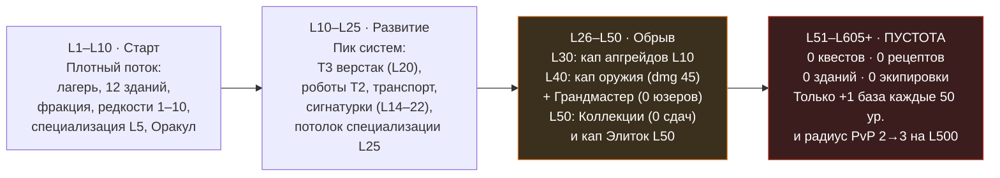
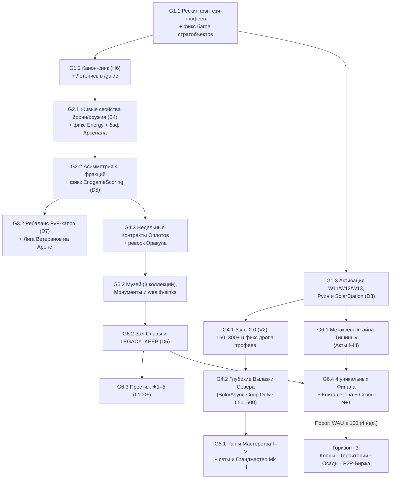

# Аудит механик, лора, сеттинга и Roadmap мид-/лейт-гейма — Wild World

> ⚠️ **Сверено 2026-11-26** (`docs/specs/audit-wave1-1126/report.md`): часть утверждений волны 1 опровергнута фактами прода (ночной OOM, индекс `map(x,y)`, список спящих флагов). Операционный план — только `ROADMAP.md`; пункты отсюда берутся в работу лишь после такой сверки.

> **Назначение документа.** Глубокий геймдизайнерский и нарративный аудит Wild World: реальная кривая прогрессии, системная диагностика «пустоты» в мид-гейме (L25–100) и лейт-гейме (L100–600+), аудит лора, сеттинга и асимметрии фракций — а также поэтапный roadmap развития механик и мира.
>
> **Конституционная рамка.** Все предложения проверены на совместимость с [`GAME_RULES_AND_VALIDATION_FRAMEWORK.md`](../../GAME_RULES_AND_VALIDATION_FRAMEWORK.md) (🔴 запреты: без P2W, без инстант-завершения за валюту, без фэнтези/магии в постапоке, без lying descriptions, без беззащитного офлайн-вайпа, без календарных сезонов без победы фракции, с сохранением инварианта 1:1 «фракция → финал»; все числа баланса — в `GameSettings` по ADR-024).
>
> **Связь с `ROADMAP.md`.** Операционной очередью остаётся корневой [`ROADMAP.md`](../../ROADMAP.md). Ключевое отличие этого документа от старого архивного `ROADMAP-100-SESSIONS` — **двухгоризонтная модель**: мы разделяем эндгейм, который работает **уже сегодня на текущей живой когорте (~25 WAU, 5–12 ветеранов L100–605)**, от массового кланово-территориального эндгейма, который имеет смысл только при **WAU ≥ 100**.
>
> **Дата аудита:** 2026-11-26 · **Источники:** код `app/`, миграции, `GAME_DESCRIPTION.md`, `mmorpg-vault/lore/`, производственные срезы `D-SREZ`, `roadmap-100-refactor/report.md`, `NODES_BALANCE.md`, `BUILDING_BUFFS_AUDIT.md`.

---

## 1. Главный диагноз: почему игроки L50–600+ не знают, что делать

Данные прода (`D-SREZ`, `roadmap-100-refactor/report.md`) показывают парадокс:
- В игре ~715 персонажей, ~25 WAU / ~56 MAU, при этом **самое активное ядро игры — это 5–12 ветеранов уровня L104–L605** (лидер делает >13 000 действий за 30 дней) и ещё ~31 игрок в диапазоне L25–99.
- При этом **авторская прогрессия игры заканчивается между L25 и L50**. Всё, что выше L50, превращается в инерционное накопление чисел без новых решений, вызовов и целей.

### Карта реальной кривой прогрессии в коде

### Восемь системных причин «пустоты» мид- и лейт-гейма (подтверждено кодом)

1. **Бесконечный линейный уровень + плоские 100 HP + пассивный стат-крип:**
   - Формула уровня `floor((exp + str + agi + int) / 4.0)` (`HealthRegenerationHandler.php:181-193`) не имеет кривой замедления или потолка.
   - `health` жёстко ограничен **100.0 HP навсегда** — у ветерана L605 ровно столько же HP, сколько у новичка L1.
   - **Спортзал L10** даёт `+0.15 STR / 30 мин` = **+7.2 Силы/сутки = +1.8 уровня/сутки пассивно бесконечно** (`building.gym.strength_cap = 0` в `GymProductionHandler.php:101`).
   - **Скважина L10** (28 800 воды/сут) и **Теплица L10** (21 600 еды/сут) полностью отключают механику выживания даже для L600 в биоме опасности 8 (нужно лишь 864 еды и 1 008 воды/сут).

2. **Жёсткие потолки PvP и «уравнённая» Арена обесценивают прокачку:**
   - В полевом PvP (`PvpFormulaService.php:42-66`, `GameBalance.php`): бонус Силы упирается в **+10% уже на 100 STR** (STR 100 = STR 1 000!), разница уровней — в **±10% при ±5 ур.**, уворот — в **75% при 300 AGI**. Дуэль двух ветеранов L300+ превращается в затяжную серию из 75% промахов до эскалации раундов.
   - При этом `One-Shot` (`levelDiff >= 50` → до 50% мгновенной смерти) при пороге PvP L5 превращает полевой PvP в избиение новичков, а не конкуренцию равных.
   - На Арене (`DuelService.php:64-79`) все бойцы уравниваются до **L20 / 50 статов / 200 HP**, поэтому ветеранская прокачка не работает и там.

3. **Узлы («Хозяева узлов», ADR-137) слабее аудитории в 3–10× и имеют сломанную петлю трофеев:**
   - На проде 24 узла имеют уровни **L5–L47** против живых бойцов **L104–L605** → **32 победы из 33 боёв (97%)**, 18 из 21 последних убийств — один игрок L605 в одиночку (`D-SREZ` §8).
   - Формула эскалации (`NodeLevelCurve.php:76-88`) ограничивает рост `base + 40`, то есть самый северный узел никогда не вырастет выше **L84** (при заложенном `max_level = 180`).
   - **Критическая поломка петли лута:** соулбаунд-трофеи «Метка пустоши» требуют `combat.nodes.soulbound_min_level = 50` (`BossLootService.php:175`). Поскольку все 24 живых узла имеют уровень L5–47, **ни один узел на проде физически не может дропнуть трофей!** А даже когда сможет — трофей бафает урон *только против самих Узлов*, замыкая систему саму на себя.

4. **Потолок крафта, мёртвые свойства экипировки и провал фракционных сигнатурок:**
   - Сигнатурное оружие фракций (L14–22, урон **32–40**) слабее универсального T3 `HydraPlasmaCannon` (L40, урон **45**), сложнее в доступе (нужен стратобъект + Проф. верстак) и имеет **100% неработающие спецэффекты** (`armor_pierce`, `energy_burst`, `stealth_strike`, `sweep` в `EquipmentService.php:90` не читаются). У `TechnoBeamShotgun` тип урона `'Energy'` не распознаётся в `PvpDamageCalculator.php:230-241` и молча падает в `physical_resistance`! Итог на проде: **1 закрытый квест из 12** (1 Коса, 0 Винтовок/Дробовиков/Ножей).
   - Броня: `EffectService.php:35-41` сравнивает JSON/текст с `'damage_reduction'` → **0 срабатываний**; `speed_modifier`, `stealth_modifier`, `bonus_type`, `special_bonus` мертвы.
   - `ItemModifierService` (заточка до +25% / Грандмастер L40 до +50%) и `CollectionService` (Музей L50) имеют **0 пользователей на проде** — нет весомой причины их искать и качать.
   - Минимальный пол времени крафта (`craft.min_duration_min = 10` мин в `CraftDurationService.php:89-91`) съедает стек поздних бафов (`Мастерская L10 × Лаборатория L10 × Специализация × Сытость × Проект фракции`).

5. **Экономический застой и отсутствие wealth-scaled голд-синков:**
   - **93,5% золота мира** сосредоточено у топ-5 игроков (последствие закрытого эксплойта F6 + отсутствие крупных трат).
   - Суммарный налог всех 15 зданий — всего **~11 470 золота/день**; личная страховка — **0,5% золота** (`InsuranceCalculator.php:64`); потолок ставки Оракула — 5 000; порог проекта фракции — 20 000. Ветерану с миллионами **некуда тратить золото** с ощутимым эффектом.
   - `Arsenal` (L15, 4 зависимости, самый дорогой налог 2 000/день) до сих пор не даёт никакого боевого/крафтового бонуса — только слот экипировки.

6. **Сломанный и «пустой» Эндгейм (гонка фракций 75 000 очков):**
   - **Сломан паритет фракций в `Config\EndgameScoring.php:76-90`:** апгрейд здания даёт +200 очков фракции здания (а не игрока!): **Инженеры получают очки с 6 зданий**, Милитари — с 4, Фермеры — с 2, а **Партизаны — с 0 зданий!!** (Оборонные постройки не привязаны вовсе.)
   - `recordCraftedItem()` (`+10` очков) не вызывается ниоткуда.
   - **Все 4 финальных сценария (`Доминирование`, `Анархия`, `Научный прорыв`, `Эвакуация`) в `EndgameThresholdHandler.php` — одинаковая заглушка:** +50 000 золота, +5 к статам и общий текст.
   - **Нет слоя Наследия (`D6`):** в `WipeManifest.php:171-175` достижения, титулы, коллекции и PvP-ладдер помечены как `PLAYER_DATA` — то есть при сезонном сбросе сгорает вся история героев.

7. **17+ выключенных флагов прячут уже построенный мидгейм-контент:**
   - В коде уже лежат, но выключены: `W11` ветвящиеся квесты, `W12` фракционные эпилоги (L16–24), `W13` финальная цепочка **«Сердце острова»** (L20→30), буст и гейт `SolarStation`, `inventory.weight_cap`, `settlements.ruins.enabled`, `tribute.enabled` (где к тому же `max_level_gap = 10` отсекает всех ветеранов L200+!).

8. **Ошибочная ставка прошлого плана на «кланы при 25 WAU»:**
   - Кланы, рейды на 5+ человек, осады штабов и P2P-аукцион требуют ликвидности (WAU ≥ 100). Пока онлайн ~25 WAU, эндгейм **обязан** работать в режиме **соло + асинхронный микро-кооп (1–5 человек, сессии по 5 минут)**, плавно перерастая в клановый слой при росте аудитории.

---

## 2. Аудит лора, сеттинга и идентичности фракций

### 2.1 Что уже сильно и должно стать опорой
- **Тон и визуальный канон (ADR-022, ADR-062):** «Найденная фотоплёнка», сухой и приземлённый постапокалипсис, голос **Роби** (`mmorpg-vault/lore/Роби.md`) — сильный, узнаваемый почерк.
- **Живой каркас мира (построен, но недораскрыт):** 4 фракционных оплота в среднем поясе Y400–560 (`Бастион` / Варга, `Схрон` / Тень, `Мастерские` / Дитрих, `Артель` / Марта), 4 нейтральных именных NPC (`Корвин`, `Карн`, `Полынь`, `Ворон`) с ветвящимися диалогами (268+ узлов) и памятью отношений, 3 северных босса (`Шрам`, `Прототип «Цербер»`, `Патриарх Стаи`), намёки на «Тишину» / «Коллапс» / «Предтеч» / «Сердце острова» в выключенных ветках W12–W13.

### 2.2 Прямые нарушения канона, сеттинга и честности (требуют правки)

| # | Проблема | Где в коде / доках | Какое правило нарушено |
|---|---|---|---|
| 1 | **Фэнтези-артефакты в постапоке:** `Сердце Дракона`, `Корона подземного короля`, `Древняя Книга`; «мистические эффекты» у Северного сияния | `resources`, `Adr119SeedCollectionsContent.php:62-64`, `GAME_DESCRIPTION.md:462,490` | 🔴 Правило §4.3 («никакой фэнтези-магии/средневековья/драконов») |
| 2 | **Врущие описания оружия и брони:** спецэффекты 4 сигнатурок (`armor_pierce` и др.), `special_bonus` / `speed` / `stealth` брони, `Arsenal` | `S25AddFactionWeapons.php`, `EffectService.php:35`, `EquipmentService.php:90` | 🔴 Правило §4.4 (anti-lying descriptions) |
| 3 | **Рассинхрон `GAME_DESCRIPTION.md` с кодом (`H6`):** устарел с `v0.51.148`; нет Узлов, Поселений, Оракула, Дронов, Подати, Заточки, Коллекций; упоминает «T4»; врёт про порядок еды (написано «редкие первыми», код ест `rarity DESC` = обычные первыми); обещает PvP-модификаторы фракций (в коде 0); упускает `IslandFarm` в §746 | `GAME_DESCRIPTION.md:336,471,698,746`, `FoodAndWaterConsumptionHandler.php:148` | 🟢 Канон-синк, П3 (Лорщик) |
| 4 | **Баг лута стратегических объектов:** у `Technopark` крафт-предмет `Wiring` записан в `resources`; `Bunker` дропает L1 `PipeGun`/`MetalSpear` за L20-замком | `AddStrategicObjects.php` | 🔴 Честность и здравый смысл награды |
| 5 | **В `/guide` нет раздела «История острова»:** механики описаны, но игрок не понимает, *что такое Коллапс, кто такие Предтечи, откуда взялись Узлы и почему 4 фракции спорят за 4 разных финала* | `GuideCatalog.php` | П3 (Лорщик), вовлечённость в эндгейм |

### 2.3 Асимметрия 4 фракций: обещание канона vs реальность кода

Сегодня **единственной по-настоящему асимметричной механикой фракций является транспорт (ADR-174)** (`Снегоход`, `Горный велосипед`, `Автономный дрон`, `Тягловая повозка`). В остальном:
- Пассивы в бою / добыче / крафте / ферме — **отсутствуют (0%)**.
- Фракционный проект (`FactionProjectService`) — **одинаковый** у всех 4 фракций (20k золота → −10% времени крафта на 24 ч).
- Оплоты и их лидеры — одинаковая скидка 15% в лавке.
- Финальные сценарии — одинаковая заглушка.
- Очки зданий в эндгейме — сломаны в пользу Инженеров (6 против 0 у Партизан).

---

## 3. Дизайн-концепция: «Что делать игрокам на каждом этапе»

Чтобы убрать «стену» после L30, игра должна менять **тип решений игрока** на каждой стадии, оставаясь полностью асинхронной (удобной для 5-минутных сессий П2, но глубокой для П1/П4/П5/П6/П7/П8):

| Стадия | Уровни | Фантазия игрока | Главная игровая петля |
|---|---|---|---|
| **I. Выживание** *(работает)* | L1–L15 | «Не погибнуть на берегу» | Разведка, первый лагерь, еда/вода, первые рецепты, выбор специализации (L5) и фракции (L10) |
| **II. Становление** *(работает, нужна полировка)* | L15–L40 | «Собрать рабочий комплекс» | Проф. верстак, роботы T2, транспорт, оплот фракции, сигнатурный комплект, цепочка «Сердце острова» |
| **III. Мид-гейм: Фронтир и Мастерство** *(НУЖНО ПОСТРОИТЬ)* | **L40–L120** | «Стать специалистом и покорить Север» | **Асимметричные фракции** + **живые свойства экипировки и сеты** + **Узлы II тира (L50–120) с рабочей петлёй трофеев** + **Северные контракты и Руины-вылазки** + **Мастерство билда** |
| **IV. Поздний лейт-гейм: Хранители и Исход** *(НУЖНО ПОСТРОИТЬ)* | **L120–L500+** | «Определять судьбу острова и войти в Летопись» | **Глубокие асинхронные Экспедиции** + **Узлы III тира (L120–300+)** + **Проекты Оплотов и Реликвии-памятники** + **Престиж («Вторая жизнь»)** + **4 уникальных многофазных Финала острова** + **Зал славы (наследие сквозь вайп)** |
| **V. Социальный слой** *(при WAU ≥ 100)* | L60+ | «Политика, кланы и экономика игроков» | Отряды, клановые штабы, влияние на регионы, P2P-аукцион и доска контрактов, дипломатия, соуправление поселениями |

---

## 4. Roadmap по лору, сеттингу и механикам мид-/лейт-гейма

### Горизонт 1 — Чистка канона, оживление фундамента и «быстрый мидгейм» *(Работает сразу при 25 WAU)*

#### Блок G1 — Канон, сеттинг и честные описания (Лоровый фундамент)
1. **G1.1 · Изгнание фэнтези из постапока (🔴 §4.3 + §4.7 без потери имущества)**
   - Идемпотентный рескин (имена и описания без удаления записей у игроков!):
     - `Сердце Дракона` → **«Изотопное ядро „Дракон-4“»** (уцелевший микрореактор бункерного комплекса)
     - `Корона подземного короля` → **«Релейный венец Глубины»** (командный обруч-транспондер начальника подземного узла)
     - `Древняя Книга` → **«Архивный носитель Предтеч»** (защищённый полевой журнал / микроплёнка до Коллапса)
     - `Северное сияние` в `GAME_DESCRIPTION.md` → **ионосферная аномалия / электромагнитный шторм** (никакой «мистики»).
   - Связать 4 редких ветеранских трофея (+ `Отработанные ТВЭЛы`) с новыми эндгейм-коллекциями и проектами Оплотов (дать им нарративный и механический смысл, не обесценивая продажу банку).
2. **G1.2 · Большой канон-синк (`H6` + Кодекс Острова в `/guide`)**
   - Полная синхронизация `GAME_DESCRIPTION.md`, `mmorpg-vault/lore/` и `GuideCatalog.php` с реальным кодом: добавить разделы про Узлы, Поселения, Оракул, Транспорт, Дронов, Заточку, Коллекции, Подать; исправить ошибки (еда `rarity DESC`, отсутствие T4, список 4 стратобъектов, отсутствие PvP-бонусов фракций до G2).
   - Добавить в `/guide` раздел **«📖 Летопись: что известно об острове»** (в голосе Роби, media-off): Коллапс («Тишина»), оставленные комплексы Предтеч, природа Узлов (автономные охранные контуры и мутировавшие вожаки, сбившиеся вокруг маяков питания), идеологии 4 фракций и почему каждая ведёт остров к своему исходу.
   - Починить баги лута в `AddStrategicObjects.php` (`Wiring` у Технопарка, L1-мусор в Бункере).
3. **G1.3 · Ревизия и активация 17 спящих фич (`D3` — быстрый прирост мидгейма почти без нового кода)**
   - Включить и отполировать уже написанный нарративно-механический мидгейм:
     - **W11** (ветвящиеся квесты с моральным выбором), **W12** (фракционные эпилоги L16–24), **W13** (финальная сюжетная цепочка **«Сердце острова»** L20→30 — поднять потолок или сделать мостом в мидгейм L40+).
     - **`settlements.ruins.enabled`** (вылазки в руины поселений), **`building.solarstation.boost.enabled`** (реальный смысл Солнечной станции), **`npc.faction_wanderer_ratio > 0`** (живые фракционные странники на дорогах), **`caravan.bundle_chance > 0`** (богатые караваны).
   - По остальным OFF-флагам (`inventory.weight_cap`, `tribute`, `oracle.house_seed`) — принять осознанное решение (переработать под ветеранов или вырезать мёртвый код).

#### Блок G2 — Живая экипировка и настоящая асимметрия 4 фракций *(Делает выбор на L10–40 значимым)*
4. **G2.1 · Оживление спец-свойств брони и сигнатурного оружия (`B4` + 🟠 ADR)**
   - Реализовать детерминированные, прозрачные и RNG-fence-совместимые боевые свойства (либо честно убрать нереализуемое):
     - **Починить тип урона `Energy`** в `PvpDamageCalculator` (отдельное сопротивление/пробой физической брони, контрится `Техно-щитовым костюмом` Инженеров).
     - **Поднять сигнатурное оружие фракций** (или добавить апгрейд «Сигнатурка Mk II» на L50+ через Грандмастер-модификацию + трофей Узла), чтобы оно не проигрывало универсальной `HydraPlasmaCannon` и давало реальный стиль игры:
       - 🛡️ `BunkerRifle` (Милитари) — **`armor_pierce`**: игнорирует 20% брони цели.
       - 🛠️ `TechnoBeamShotgun` (Инженеры) — **`energy_burst`**: энергетический урон (эффективнее против тяжёлой брони, слабее против энергощитов).
       - 🌲 `GhostCityKnife` (Партизаны) — **`first_strike`**: +25% урона в 1-м раунде и бонус инициативы.
       - 🌾 `FarmersHarvestScythe` (Фермеры) — **`sustain_strike`**: в PvE восстанавливает +2 HP при попадании (снижает расход аптечек на затяжном фарме).
     - **Оживить броню (`armor-bonuses-revive`):** исправить баг в `EffectService.php:35` (читать структурированный JSON вместо строки `'damage_reduction'`), ввести 3–4 честных рабочих свойства (снижение входящего крита, снижение расхода выносливости в походе для лёгкой брони, защита от ран/отравления для фермерской, отражение фиксированного урона для тяжёлой).
     - **Дать реальный смысл `Arsenal` (L15):** ускорение модификации/ремонта оружия и брони + пассивный бонус к прочности экипировки (медленнее износ в боях).
5. **G2.2 · Пассивная идентичность 4 фракций и уникальные Фракционные Проекты (🟠 ADR)**
   - Каждая фракция получает **1 сквозной не-ломающий пассив** (все числа в `GameSettings`, масштабируется с рангом репутации в своём Оплоте) и **свой уникальный баф Фракционного Проекта** вместо 4 одинаковых «−10% крафта»:
     - 🛡️ **Милитари:** пассив «Дисциплина» (снижен износ оборонных построек и оружия) · Проект Оплота «Мобилизация» → баф урона против Узлов и элиток (+12% на 24 ч).
     - 🌲 **Партизаны:** пассив «Знание троп» (−15% выносливости на неизведанных клетках, +шанс уйти от нежеланного полевого боя) · Проект «Тайные тропы» → ускоренный Поход и повышенный шанс находок в руинах/объектах на 24 ч.
     - 🛠️ **Инженеры:** пассив «Автоматика» (+15% ресурс батареи дронов и длительности роботов) · Проект «Оптимизация конвейера» → −15% времени крафта и шанс сберечь 10% сырья на 24 ч (снимая конфликт с 10-мин полом для больших партий).
     - 🌾 **Фермеры:** пассив «Запасливость» (+20% к длительности «Сытости» и +15% к урожаю грядок) · Проект «Ярмарка Артели» → +10% к выкупу ресурсов у торговцев и скидка на страховку/налоги на 24 ч.
   - **Починить паритет `EndgameScoring` (`D5` + 🟠 ADR):** перенести все веса в `GameSettings`, перевести очки за апгрейд зданий на **фракцию игрока** (а не маппинг зданий, где у Партизан 0!), подключить `recordCraftedItem()`, добавить очки за закрытие Узлов и проектов Оплота.

---

### Горизонт 2 — Настоящий Мид-гейм (L40–120) и Соло/Микро-кооп Лейт-гейм (L120–600+) *(Работает на 5–50 активных игроках УЖЕ СЕЙЧАС)*

> Главная цель этого горизонта — **закрыть контентную пустоту для живых ветеранов L50–605**, не требуя онлайна 100+ WAU и не нарушая офлайн-контракт казуалов (П2).

#### Блок G3 — Ребаланс прогрессии L50+ и боевой кривой (Убираем «плоские потолки»)
1. **G3.1 · Мягкий потолок стат-крипа и осмысленные вехи L50–300 (🟠 ADR)**
   - Ввести админ-настраиваемый **soft-cap на пассивный `Gym`** (`building.gym.strength_cap`, уже есть в коде!) — например, пассивный зал качает до STR 150, дальше сила растёт только от активной игры (Узлы, походы, экспедиции, PvP), чтобы не плодить «афк-уровни».
   - **Без ретро-нерфа существующих ветеранов (🔴 §4.7):** ввести **Ветеранские вехи (L50 / L75 / L100 / L150 / L200 / L300)**, видимые на экране «👤 Перс → 📈 Путь выжившего», где каждая веха открывает механическую опцию (см. G4–G5 ниже), а не просто цифру.
   - **Переосмысление HP/выживаемости в лейт-гейме:** вместо плоских 100 HP рассмотреть *тактический запас брони/щитового буфера* от тира экипировки и заточки (не ломая существующие формулы урона событий в % от max HP).
2. **G3.2 · Честный PvP и Арена для ветеранов (`D7` + 🟠 ADR с кривой побед)**
   - Перенести PvP-потолки из `Config\GameBalance` в `GameSettings` (`D7`).
   - **Заменить жёсткие клиффы на убывающую отдачу (diminishing returns):** вместо глухого потолка `+10% на 100 STR` — плавная логарифмическая кривая (например, до +25% к STR 500), чтобы L300 чувствовал свой прогресс против L120, но билд/броня (75% формулы) оставались решающими.
   - **Смягчить токсичный `One-Shot` против новичков:** ограничить полевую атаку по разнице уровней (или перенести `One-Shot` только в северный пояс `Y < 300` — «Зону без правил», оставив центральный пояс честным).
   - **Две лиги Арены:**
     - *Классическая (Уравнённая)* — текущий честный формат L20/50/200HP для всех (рейтинг навыка билда).
     - *Лига Ветеранов (Без уравнивания, L50+)* — бои в реальной экипировке, с реальными статами, модификаторами и фракционными свойствами, без потери лута, но с отдельным престижным рейтингом и еженедельными трофеями (дает ветеранам L100–605 повод оптимизировать билд!).
   - Закрыть фарм «груш» L2 (`D9`): не показывать в списке дуэлей неактивных >14 дней игроков и добавить убывающую отдачу очков на одного оппонента (`F18`).

#### Блок G4 — Узлы 2.0, Северный Фронтир и Замкнутая петля лута (L40–300+)
3. **G4.1 · Масштабирование Узлов до L50–300+ и починка петли трофеев (`V2` + 🟠 ADR)**
   - **Срочный фикс `V2`:** перенастроить `world.nodes.*` по широтным поясам так, чтобы появились 3 живых тира Узлов:
     - **Юг/Центр (Y 500–850):** Узлы **L15–L45** (соло для новичков и мид-игроков с оружием).
     - **Средний Север (Y 250–500):** Узлы **L60–L120** (вызов для элитного соло L100–200 или дуэта; гарантированно выше `soulbound_min_level = 50` → **трофеи наконец начинают падать!**).
     - **Глубокий Север (Y 1–250):** Узлы **L150–L300+** с фазовой механикой и сильной реген-стеной (асинхронная «Облава» на 2–5 ветеранов за 12–24 ч окно, а не за 5 минут — идеально для 5–12 активных L100+!).
   - **Убрать искусственный зажим `base + 40`** для северного пояса, разрешив эскалацию до `world.nodes.max_level` (180 → 300).
   - **Дать трофеям «Метка пустоши» смысл вне Узлов:** трофей-фрагменты становятся обязательным реагентом для:
     1. **Модификации Грандмастера (+25% → +50%)** — оживляет мёртвый `ItemModifierService` (сейчас 0 пользователей);
     2. **Апгрейда фракционной сигнатурки до «Mk II» (L60+)** и **комплектов снаряжения (2 предмета: оружие + броня своей фракции = сет-бонус)**;
     3. **Постройки Реликвии/Монумента базы** и **Запуска Северных экспедиций**.
4. **G4.2 · Глубокие вылазки и Асинхронные Экспедиции (Главный PvE-цикл L50–600+)**
   - **Механика «Вылазка в Бункер / Аномалию» (Многоэтапный Solo/Async-Coop Delve):**
     - Игрок (соло или с 1–3 союзниками асинхронно) выбирает маршрут глубины **Этаж 1 → 5** в точках Глубокого Севера (`Y < 300`).
     - Каждый этаж — фоновая фаза 30–90 мин (вписывается в коридор 10 мин – 12 ч, 🔴 §4.5 соблюдён) + **точка решения** (как в Походе): выбрать риск (пойти глубже за лучшим лутом и редким компонентом / эвакуироваться с добычей / применить инструмент специализации: Инженер взламывает терминал, Медик нейтрализует биоугрозу, Оружейник пробивает завал).
     - **Офлайн-безопасность (П2):** при остановке между этажами прогресс ждёт до 24 ч, а гибель внутри вылазки сжигает только невынесенный лут вылазки (база и страховка нетронуты).
   - **Синк провизии и расходников:** в Глубоком Севере требуются **Консервы (Тушёнка/Сухпаёк)**, полевые лекарства (`D-DEAD-RES`), заряженные дроны и ремонт — это впервые связывает воедино ферму, готовку, аптеку, дронов и эндгейм-PvE!
5. **G4.3 · Еженедельные Контракты Оплотов и «Живой Оракул»**
   - **Контракты Оплота (L30+, L80+, L150+):** каждую неделю лидеры 4 оплотов (`Варга`, `Тень`, `Дитрих`, `Марта`) выдают 3 ступенчатых заказа (добыча редкого сырья Севера, зачистка элиток/Узла, поставка сложных крафт-партий). Награда: репутация Оплота, очки фракции в эндгейм, уникальные чертежи модификаторов и **печати заказа** (обмен на косметику, трофеи коллекций, редкие компоненты).
   - **Починка Оракула для 25 WAU:** добавить 2 новых автоматических рынка (например, «Какая зона Севера понесёт больше всего потерь Узлов за неделю?», «Ресурс с максимальным ростом цены за 48ч»), ввести **ветерано-лимит ставки** (пропорционально уровню, до 50k–100k золота при наличии пула) и публичный лидерборд предсказателей (престиж, без эмиссии золота — ADR-133).

#### Блок G5 — Мастерство, Базы 2.0, Wealth-Sinks и Экономика ветеранов
6. **G5.1 · Горизонтальное Мастерство поверх Специализации (Расширение ADR-047/048, не дубль)**
   - Сейчас специализация (`Оружейник` / `Медик` / `Инженер`) заканчивается на **L25**.
   - Расширить её **рангами Мастерства I → V** (открываются на L30 / L60 / L100 / L150 / L250 за реальные действия — скрафчено, починено, исследовано, побеждено Узлов — плюс крупный золотой взнос-сертификация у мастера Оплота):
     - Дают **качественные перки** (не сломанные проценты): например, шанс сберечь редкий компонент при крафте, +1 слот активной очереди крафта, возможность дистанционного запуска крафта в покрытии Вышки связи (закрывает идею игрока `IDEA-DRONE` с соблюдением канона Вышки!), +1 слот активной грядки/модификатора, уникальный титул в профиле и упоминание в репликах NPC Оплота.
7. **G5.2 · «Склад-музей», Монументы базы и осмысленные Gold-Sinks для миллионеров**
   - Чтобы безболезненно выводить излишки золота у когорты L100+ (93,5% денежной массы), ввести **прогрессивные и статусные синки** (без P2W и без инстант-ускорений):
     1. **Монументы и Проекты Оплота (Tier II–III):** дорогие многоступенчатые вклады (100k / 500k / 2M золота + редкие ресурсы) в обустройство Оплота своей фракции и личные Монументы базы (переживают вайп в Зале славы!).
     2. **Прокачка Музея коллекций (L50+):** расширить `CollectionService` с 2 до 8 тематических экспозиций (Биомы, Оружие Доколлапса, Архив Предтеч, Трофеи Узлов, Редкие ресурсы) с видимым прогрессом на публичном веб-профиле `/profile/{id}` и витриной в боте.
     3. **Мастерская переплавки / Конверсия излишков:** платная (золото-синк) переработка накопленного обычного сырья и ненужного лута в «Стабилизированные сплавы / Полимеры» — базовый материал для Грандмастер-заточки и вылазок.
     4. **Прогрессивный налог на мульти-базы (ADR-095 Ф2):** 1-я база сохраняет базовый дешёвый налог (защита казуалов П2), 2-я база — ×1.5, 3-я+ — ×2.5 — естественный сдерживатель инфляции для L100–600+.
     5. **Люкс-декор и Именование ландмарков (`L29`):** за крупный вклад золота + достижение ветеран может получить право предложить имя для безымянной клетки/руины Севера (с премодерацией в админке) — вечный след на карте `wildworld.fun/map`!

#### Блок G6 — Настоящий Эндгейм: Метаквест, 4 уникальных Финала, Престиж и Сезонное Наследие
8. **G6.1 · Метаквест «Тайна Тишины» (Нарративный стержень L30 → L250+)**
   - Сшить воедино уже существующие фрагменты мира:
     - **Акт I (L15–30):** пробуждение цепочек `W12` + `W13` («Сердце острова») и знакомство с 4 лидерами Оплотов + 4 нейтралами (`Корвин`, `Карн`, `Полынь`, `Ворон`).
     - **Акт II (L50–100):** расшифровка сигналов Северных Узлов — игроки находят фрагменты логов Предтеч на Узлах II тира и в руинах; общий серверный счётчик открытий постепенно раскрывает новые записи в «Летописи острова» на `wildworld.fun` и в `/guide` (прогресс сообщества необратим!).
     - **Акт III (L120+):** раскрытие истины о Коллапсе («Остров — законсервированный испытательный полигон/ковчег с автономным контуром изоляции, который начал сбоить») — и прямое нарративное обоснование, почему 4 фракции не могут договориться: Милитари хотят взять контур под силовой контроль (**Доминирование**), Партизаны — уничтожить систему управления навсегда (**Анархия**), Инженеры — перезапустить и завершить эксперимент (**Научный прорыв**), Фермеры — отключить периметр и вывести людей с острова (**Эвакуация**).
9. **G6.2 · Слой Наследия и Зал Славы (`D6` — обязательно ДО любого финала/вайпа!)**
   - Вывести из `PLAYER_DATA` в новый класс **`LEGACY_KEEP`** в `WipeManifest`:
     - Таблицы `season_history`, `hall_of_fame` (победитель сезона, топ-вкладчики каждой фракции, первооткрыватели актов метаквеста, рекордсмены Узлов и Арены), `character_legacy_titles`, `character_prestige`, `character_collection_slots` (музей переживает сезоны!).
   - Публичная страница `wildworld.fun/hall-of-fame` (flat ADR-062) + экран «🏛 Зал славы» в боте и `/play`.
10. **G6.3 · Престиж («Вторая жизнь выжившего», L100+ опционально, 🟠 ADR)**
    - Для ветеранов L100–605+, которым хочется снова пройти путь с чистого листа **не дожидаясь глобального финала сервера**:
    - Добровольный выборочный сброс (уровень/статы/базы/ресурсы → старт L1) через расширение `WipeService` (не стирая `LEGACY_KEEP`, коллекции и титулы).
    - Награда (строго без боевого P2W-преимущества): **знак Престижа ★1..★5** в имени/профиле, вечный косметический декор лагеря, +1 слот декора/заметок, уникальные диалоговые реплики у Роби и NPC («Ты уже проходил этот путь...»), и ускоренное зачисление очков в гонку своей фракции (+5% очков фракции за квесты/Узлы, не боевой стат!).
11. **G6.4 · Четыре по-настоящему разных многофазных Финала (вместо 1 заглушки)**
    - Сохраняя 100% верность инварианту 1:1 и запрету на календарные вайпы (🔴 §4.8, §4.9, ADR-016):
    - Достижение **75 000 очков** не обрубает игру мгновенным сухим сообщением, а запускает **Кульминацию (7–14 дней «Финального Акта»)**, уникальную для победившей фракции:
      - 🛡️ **Доминирование (Милитари):** на карте появляются патрули и комендантский час в центральных биомах; победители удерживают контрольные точки, остальные фракции получают ветку Сопротивления (свои награды и титул «Несломленный»).
      - 🌲 **Анархия (Партизаны):** налоги на базы отключаются, торговые наценки сходят с ума, на Севере открывается добровольная (opt-in!) «Вольница» с удвоенным лутом и полным риском.
      - 🛠️ **Научный прорыв (Инженеры):** серверная мегастройка «Запуск Реактора Предтеч» — все игроки (включая другие фракции) могут либо ускорять этапы стройки, либо проводить диверсии, влияя на итоговый эпилог мира.
      - 🌾 **Эвакуация (Фермеры):** сбор припасов и строительство «Ковчега» на побережье — каждый игрок выбирает концовку своего персонажа: **«Уплыть»** (титул «Ушедший за горизонт») или **«Остаться хранителем острова»** (титул «Оставшийся»).
    - По завершении Финального Акта каждый участник получает **персональную «Книгу сезона»** (итоги пути, лучшая битва, вклад в исход, shareable ссылка на `wildworld.fun`), данные фиксируются в Зале славы, и владелец по объявленному контракту запускает **Новый Мир (Сезон N+1)** с лёгким сезонным модификатором (например: «Суровая зима», «Эпоха аномалий», «Богатый Север») — выбираемым голосованием игроков через существующий движок опросов!

---

### Горизонт 3 — Массовый социальный и территориальный эндгейм *(Заморожен до порога `ROADMAP.md` §0: WAU ≥ 100 четыре недели подряд)*

> Все пункты ниже уже сверены на противоречия с принятыми ADR (устранены коллизии старого `ROADMAP-100-SESSIONS`):

| Модуль | Механика | Как стыкуется с построенным (без конфликтов ADR) |
|---|---|---|
| **S-1 · Отряды и Кланы (2–15 чел.)** | Создание клана (L50+ + взнос-синк), клановая казна с журналом операций (анти-скам), общий клановый штаб на карте с общим складом и лимитами вывода по ролям, клановые метки на карте `/map` | Строится поверх `BaseScopeResolver` (ADR-187) и `FactionProjectService` (ADR-051); личные базы новичков неприкосновенны |
| **S-2 · Влияние на регионы и Узлы IV тира (L300–999)** | Сетка секторов карты получает мягкое влияние фракций/кланов (малый бонус добычи/скидки своим, **без запрета входа чужим** + убывающая отдача лидера против снежного кома); легенд-тир Узлов L500–999 (ADR-137) под клановые облавы | Не нарушает safe-зоны (`Y ≥ 900`) и офлайн-контракт П2 |
| **S-3 · Осады штабов и Логистические конвои** | Только клановые штабы (не личные лагеря!), с заранее объявленным окном (асинхронность) и ставками территориального влияния, а не «обнулением до нитки». Сопровождение грузовых конвоев игроков в опасных секторах с защитой страховки | Расширяет `pvp_standoffs` (ADR-186) и `ADR-135`; **не** конфликтует с NPC-караванами (`ADR-057`, называем «Конвои») и не отбирает транспорт (`ADR-174`) |
| **S-4 · P2P-Биржа и Доска Мастеров** | Эскроу-аукцион ресурсов и модифицированных предметов + доска заказов («скрафти мне X со своей специализацией/мастерством», залог + репутация мастера) | Опирается на `economy_ledger` (T1.4), пропорциональное затухание рынка (ADR-175) и ранги Мастерства (G5.1) — без разрушения спреда банка |
| **S-5 · Совет Поселений и Наставничество** | Топ-вкладчики поселений голосуют (через движок опросов) за недельный фокус лавки/услуг; система «Наставник ↔ Новичок» (`P4`, расширение ADR-146) с чисто статусными наградами ментору за доведение новичка до L10 | Связывает эндгейм с воронкой новичков (главная метрика `ROADMAP.md` §0) |

---

## 5. Проверка дорожной карты через 10 персон (`GAME_RULES_AND_VALIDATION_FRAMEWORK.md`)

| Персона | Что выигрывает от этого Roadmap | Проверка на «предательство контракта» |
|---|---|---|
| **П1 Хардкорщик** | Глубокий Север (L150–300+ Узлы, многоэтапные Вылазки с риском лута), живая экипировка, убранный афк-крип `Gym`, реальный смысл подготовки и консервов | ✅ Реальное время и риск/награда усилены |
| **П2 Казуал (5-мин сессии)** | Вылазки с паузами до 24 ч, асинхронные Облавы (12–24 ч окно), личная база и страховка нетронуты, 1-я база без роста налога | ✅ Офлайн-контракт защищён полностью |
| **П3 Лорщик** | Убраны фэнтези-ляпы, канон-синк, «Кодекс острова» в `/guide`, сквозной метаквест «Тайна Тишины», 4 разных финала с «Книгой сезона» | ✅ Ни одного lying description |
| **П4 PvP-хищник** | Убран глухой кап STR +10%, новая «Лига Ветеранов» на Арене без уравнивания, рабочие свойства оружия/брони, «Зона без правил» на Севере | ✅ Прозрачные формулы, узкие safe-зоны |
| **П5 Билдер-оптимизатор** | Реальный смысл `Arsenal` и `SolarStation`, 5 рангов Мастерства, переплавка, сеты + Грандмастер-заточка, удалённый крафт под Вышкой | ✅ Автоматизация не режется, глубина крафта растёт |
| **П6 Социальщик** | Уникальные проекты 4 Оплотов, честный баланс очков фракций (починены Партизаны!), асинхронные Облавы, затем Кланы при WAU ≥ 100 | ✅ Инвариант 1:1 фракция→финал усилен |
| **П7 Завершенец** | 8 коллекций Музея, Зал славы (`LEGACY_KEEP` сквозь вайп), Престиж ★1–5, вехи L50–300, «Книга сезона» | ✅ 0 ретро-удалений; вайп только после финала |
| **П8 Экономист** | Новые wealth-scaled синки (Монументы, Оплоты, прогрессивный налог 2-й+ базы, переплавка, Оракул), затем P2P-биржа | ✅ Новых «золотых кранов из воздуха» нет |
| **П9 Анти-P2W** | Престиж и Зал славы — статус и косметика без продажи силы; все шансы/кривые открыты и в `GameSettings` | ✅ 100% честный F2P |
| **П10 Новичок** | Онбординг Роби не усложнён; защита от `One-Shot` в центральном поясе; в будущем — Наставничество от ветеранов | ✅ Ранняя игра защищена и понятна |

---

## 6. Рекомендуемая очерёдность реализации (Быстрые победы → Системная глубина)

### Первые 5 шагов с максимальным эффектом для живых ветеранов уже в ближайших релизах
1. **`G4.1` (Узлы 2.0 / `V2`)** — почти полностью через настройки `GameSettings` + мелкий фикс потолка эскалации: мгновенно даёт живым игрокам L100–605 настоящих боссов и чинит сломанный дроп трофеев (`level >= 50`).
2. **`G1.3` (Включение `W11`/`W12`/`W13` «Сердце острова» + Руины + `SolarStation`)** — разблокирует уже написанные в коде мидгейм-квесты и лор без месяцев разработки.
3. **`G2.1` + `G2.2` (Живые сигнатурки, броня, фикс `Energy`, паритет `EndgameScoring` для Партизан и уникальные проекты Оплотов)** — превращает фракции из косметического тега в 4 разных стиля игры.
4. **`G3.2` (Снятие глухого потолка STR +10% и «Лига Ветеранов» на Арене)** — возвращает смысл прокачке L100+ в PvP без ущерба для новичков.
5. **`G4.2` + `G6.2` (Северные Вылазки + Слой Наследия / Зал Славы)** — создаёт бесконечный, асинхронный эндгейм-цикл, в котором задействованы еда, медицина, дроны, заточка и трофеи, и готовит сервер к первому настоящему Финалу.
