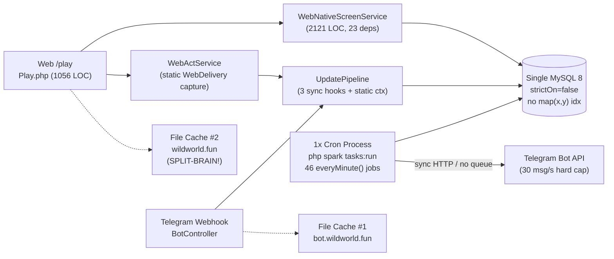
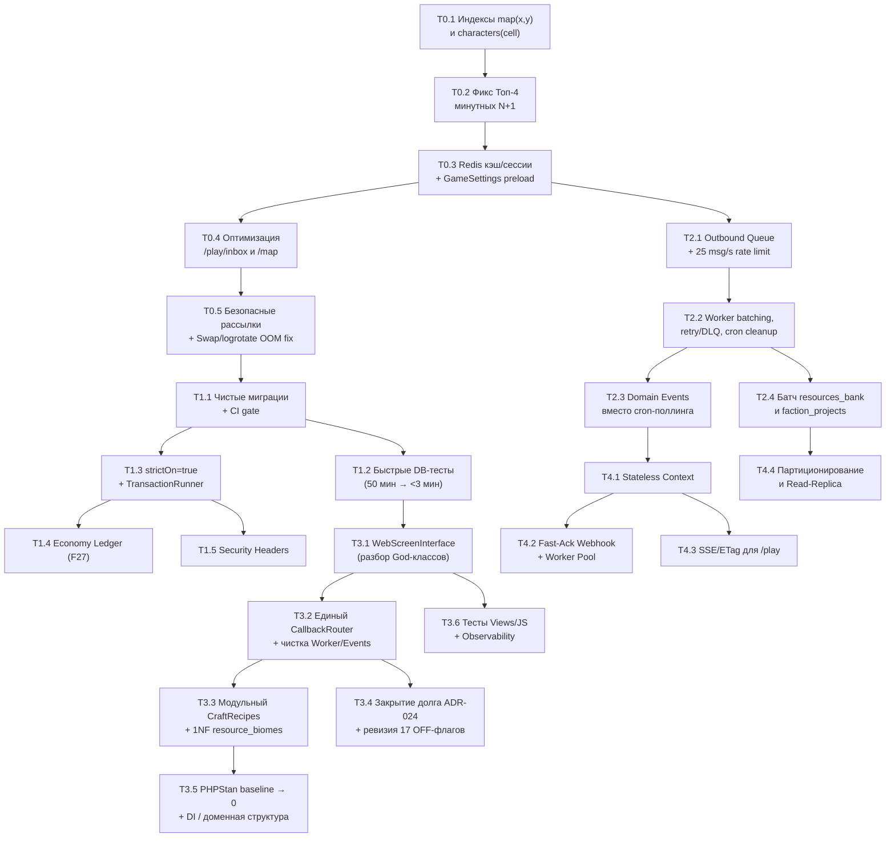

# Технический аудит и Roadmap развития — Wild World

> ⚠️ **Сверено 2026-11-26** (`docs/specs/audit-wave1-1126/report.md`): часть утверждений волны 1 опровергнута фактами прода (ночной OOM, индекс `map(x,y)`, список спящих флагов). Операционный план — только `ROADMAP.md`; пункты отсюда берутся в работу лишь после такой сверки.

> **Назначение документа.** Глубокий технический аудит кодовой базы Wild World (`PHP 8.3`, `CodeIgniter 4.7`, `MySQL 8 / MySQLi`, `longman/telegram-bot 0.81`) и поэтапный технический roadmap развития: архитектура, паттерны, тестирование, оптимизация БД и воркеров, расширяемость, безопасность и масштабирование от ~25 WAU до 10 000+ WAU.
>
> **Связь с `ROADMAP.md`.** Единственной операционной очередью исполнения остаётся корневой [`ROADMAP.md`](../../ROADMAP.md) (согласно [`CONTRIBUTING.md`](../../CONTRIBUTING.md)). Настоящий документ является стратегическим исследованием и техническим планом-справочником, пункты которого берутся в работу через стандартный конвейер VULYK и 7 ворот [`GAME_RULES_AND_VALIDATION_FRAMEWORK.md`](../../GAME_RULES_AND_VALIDATION_FRAMEWORK.md).
>
> **Дата аудита:** 2026-11-26 · **Срез кода:** ветка `develop` (~`v0.51.714`) · **Объём базы:** ~80 моделей, ~247 сервисов в 40 доменах, ~346 контроллеров/handler'ов, 74 TaskHandler'а, 524 миграции, 585 тест-файлов (~5 096 тестов).

---

## 1. Резюме аудита (Executive Summary)

Проект прошёл колоссальную эволюцию от монолитного Telegram-бота к **трёхповерхностной платформе** (Telegram-бот + публичный сайт + нативный веб-клиент `/play` + админка) с высокой инженерной культурой: PHPStan Level 9, 585 тест-файлов, `ConditionalWriteService` (ADR-181), `GameSettings` (ADR-024), `WipeManifest` (ADR-087), детерминированный `EventDispatcher` (F7) и формализованные дефект-чеки.

Однако быстрый продуктовый рост поверх исторического ядра накопил **системный техдолг**, который уже сегодня замедляет разработку и создаёт **жёсткие потолки масштабирования**:

| Измерение | Текущее состояние | Главная проблема |
|---|---|---|
| **БД и индексы** | 1 млн строк в `map`, `strictOn => false` | Миграция индексов `2024-09-26` оказалась **тихим NO-OP** (забыт `processIndexes()`): нет `map(coordinate_x, coordinate_y)` и `characters(cell_number)`; `php spark migrate` падает на пустой БД |
| **Кроны и N+1** | 58 задач в `Config\Tasks`, **46 каждую минуту** в одном процессе | Жёсткие N+1 бомбы: `CharacterDataHandler` (`O(N×M)` = 7 700+ SQL/мин), `AutoPveHandler`, `EventDispatcher` (6–9N SQL/мин), `ResourceBankUpdateHandler` (80 транзакций/мин) |
| **Кэш и мульти-хост** | `FileHandler` на двух раздельных деплоях (`bot.wildworld.fun` и `wildworld.fun`) | **Split-brain кэша**: правка `GameSettings` не сбрасывает второй vhost; PvP/телепорт-кулдауны и rate-limit не общие между Telegram и `/play`; `GameSettingsService` делает file I/O на каждый ключ без батч-загрузки |
| **Архитектура / DI** | `service()` — 46 вызовов против **1 596 `new *Model`** и **759 `new *Service`** | God-классы (`CraftRecipes` 3 572 LOC, `WebNativeScreenService` 2 121 LOC / 23 зависимости, `AttackPlayerAction` 1 086 LOC, `Play` 1 056 LOC); статическое глобальное состояние `WebDelivery` блокирует worker-режим PHP |
| **Тестирование и типы** | ~5 096 тестов + PHPStan L9 | **2 945 ошибок** скрыто в `phpstan-baseline.neon`; 203 DB-теста делают `DROP/CREATE TABLE` в `setUp()` каждого метода (прогон бьётся на 10 чанков по ~300 с); 0 автотестов на Views и ~1 050 LOC JS |
| **Потолок масштаба** | ~25 WAU / ~715 персонажей | **Первая стена — 300–500 WAU** (таймаут рассылок, перехлёст минутного крона, сканы `map`); **жёсткий потолок — 1 500–2 000 WAU** без Redis и очереди исходящих сообщений |

---

## 2. Глубокий разбор по 7 техническим осям

### 2.1 Архитектура, паттерны и разделение ответственности

1. **Два клиента (Telegram + Web `/play`) и распухание Neutral Core (ADR-189 / ADR-190):**
   - Стратегия «нейтральное ядро экранов + тонкие рендереры» (ADR-190) — архитектурно верная, и перенос 14 карточек построек в `BuildingCardService` (W2.N4b) доказал её эффективность.
   - Но точка сборки на вебе превратилась в два god-класса: `app/Services/Web/WebNativeScreenService.php` (**2 121 LOC, 23 зависимости в конструкторе**) и `app/Controllers/Play.php` (**1 056 LOC**, гигантский `if/elseif` в `viewScreen()` `:241-563`).
   - Мост ADR-189 (`WebActService` + `WebDelivery`) использует **process-global mutable static state** (`WebDelivery.php:52-66`: `$capturing`, `$actorChat`, `$buffer`, а также `DeliveryContext`, `PlayerActionLogger::current()`, `ActionOrigin`, `TelegramBridge::$telegram`). Это намертво привязывает приложение к shared-nothing PHP-FPM и исключает ре-ентрантный вызов, FrankenPHP worker-mode или асинхронные воркеры.
   - Fallback-мост (`BRIDGE_ROUTES`, `CARD_BRIDGE_SEP`) местами эмулирует 3–4 последовательных нажатия бота внутри одного веб-запроса, умножая латентность и число SQL-запросов.

2. **Отсутствие реального DI и брошенный Repository-слой:**
   - В `app/Config/Services.php` зарегистрировано лишь 4 прикладных сервиса (`auth`, `characterRepository`, `handlerRegistry`, `duelCoin`). По всему `app/` насчитывается **1 596 прямых вызовов `new *Model()`** и **759 вызовов `new *Service()`** против 46 вызовов `service()`.
   - Папка `app/Repositories/` содержит единственный `CI4CharacterRepository`, вызываемый 1 раз.
   - Модели перегружены бизнес-логикой и побочными эффектами: `CharacterModel` (256 LOC, 49 `$allowedFields`) форматирует UI-тексты (`getCharacterInfoAsString()`) и ходит в соседние таблицы; **`app/Models/MapModel.php:7` вызывает `ini_set('memory_limit', '1G')` на уровне загрузки файла**, а `fetchAllMapData()` (`:47-51`) вычитывает 1 000 000 строк без пагинации.

3. **Четырёхслойная фрагментация маршрутизации команд и callback'ов:**
   - `CallbackqueryCommand.php` (`:35-77`) диспетчеризует колбэки через 4 независимых механизма: инлайн-ветку `'character'`, `CallbackRouter` (который пересоздаётся `new CallbackRouter()` на **каждый** запрос с линейным проходом по regex!), `CallbackPrefixDispatcher` (18 жёстко упорядоченных `str_starts_with`) и `Config\CallbackRoutes` (611 LOC, ~250 точных ключей + `$prefixRoutes`).
   - `Worker::getHandlerClassName()` (`:465-518`) аналогично держит 3-уровневый fallback: БД `tasks.handler_key` → `HandlerRegistry` → `$taskHandlerKeyMap` (~100 записей) → дублирующий `$taskHandlerMap` (~100 записей).

4. **Крупнейшие God-классы (кандидаты на декомпозицию):**
   - `app/Config/CraftRecipes.php` — 3 572 LOC (монолитный PHP-массив, дублирующий БД `crafted_items` + `tasks`)
   - `app/Services/Web/WebNativeScreenService.php` — 2 121 LOC
   - `app/Controllers/Telegram/Commands/Actions/PVP/AttackPlayerAction.php` — 1 086 LOC (13 моделей + 5 сервисов)
   - `app/Services/Community/CommunityGuard.php` — 1 081 LOC
   - `app/Services/Onboarding/GuideCatalog.php` — 1 079 LOC
   - `app/Controllers/Play.php` — 1 056 LOC
   - `app/Services/PVE/BossEncounterService.php` — 1 053 LOC
   - `app/TaskHandlers/MarchingTaskHandler.php` — 1 012 LOC
   - `app/Services/Craft/CraftOrderService.php` — 968 LOC
   - `app/Services/PVE/TributeService.php` — 966 LOC
   - `app/Views/site/map.php` — 954 LOC (~700 LOC инлайн-JS без сборки/минификации)
   - `app/TaskHandlers/TaxCollectionHandler.php` (841 LOC), `GenericmessageCommand.php` (841 LOC), `MarchService.php` (818 LOC).

5. **Дробление доменов `app/Services/`:**
   - `Services/Player/` разросся до **85 файлов** (смешаны статы, торговля, смерть, телепорты, дроны, подсказки).
   - Параллельно существуют дублирующие по смыслу папки: `Craft/` (15), `Crafting/` (1), `CraftCalculator/` (1), `CraftTree/` (1); `Bases/` (12), `Buildings/` (6), `BuildingEffects/` (2), `Housing/` (1).

---

### 2.2 Атомарность, транзакции, конкурентность и целостность данных

- **Что сделано отлично (сильные примитивы):**
  - `ConditionalWriteService` (ADR-181): CAS-списания (`decrementIfAtLeast`, `transitionIfCurrent`, `insertUnique`), дедуп `update_id` в `telegram_updates_seen`, fail-closed webhook secret (S4).
  - `CharacterStatsService::mutate()` (ADR-151): `SELECT ... FOR UPDATE` в явной транзакции.
  - `S1`: `UNIQUE` на `quest_steps(quest_id, character_id)`, `character_resources(id_characters, id_resources)` и `VIRTUAL`-колонка `character_tasks.exclusive_slot` (ADR-199).
  - `Config\WipeManifest` (ADR-087) с CI-гейтом `WipeManifestCoverageTest`.
- **Открытые системные риски:**
  1. **`strictOn => false`** в `app/Config/Database.php:42,67` (и на проде, и в тестах): MySQL молча усекает строки/числа и подставляет нули в `NOT NULL` поля без `DEFAULT` (открытый пункт `S1b`).
  2. **Липкий `transStatus` в CI4 и отсутствие `SAVEPOINT`:** часть сервисов (`ResourceTradeService::bulkSellResources()`, `FactionProjectService::deposit()`) смешивает `transStart()`/`transComplete()` с ручным `transRollback()`, а вложенные вызовы (`CraftShortfallBuyAction` → `buyResource()`) держатся на счётчике глубины без реальных `SAVEPOINT`.
  3. **Неполные транзакционные границы:** списание заряда `PortableTeleport` (`TeleportItemConsumer`) и само перемещение + `revealAround()` не объединены в одну транзакцию.
  4. **Отсутствие финансового и предметного леджера (F27 / `S3`):** без append-only журнала движения золота и дорогих предметов невозможно проводить форензику инцидентов и доказать отсутствие эксплуатации (урок инцидента F6 на 75,8 млн золота).
  5. **Фоновая обработка без ретраев и батчинга:** `Worker::processTasks()` (`:71-74`) выбирает все просроченные `character_tasks` без `LIMIT`, а любое `Throwable` переводит задачу в `status='interrupted'` (`:141-150`) без retry/DLQ — игрок молча теряет завершение.

---

### 2.3 Качество кода, статический анализ и управляемость балансом

- **PHPStan Level 9 с долгом 2 945 ошибок (`phpstan-baseline.neon`, 2 546 записей):**
  - Главный источник шума — нетипизированные возвраты CI4 `BaseModel` (`array|object|null`), из-за чего новый код перегружен защитным бойлерплейтом (`rowToArr()`, `is_numeric()`).
  - `app/Database/Migrations` и `app/Views/{site,admin}` исключены из PHPStan; при этом в `.github/workflows/deploy.yml` **нет шага `php -l` на миграциях** (ломается только на деплое!).
- **Двойная правда баланса (`GameBalance.php` vs `GameSettings`):**
  - Вопреки ADR-024 (`CLAUDE.md` правило #2), `Config\GameBalance.php` (383 LOC), `Config\EndgameScoring.php` (115 LOC), `Config\CraftRecipes.php` (`gold_required`), `ResourceBankUpdateHandler` (коридор `0.35–3.5`, спред `×0.95/×1.05`), `GoldGrantEffect` и `trading_karma (0.0002)` всё ещё хранят баланс в коде.
- **Разрастание выключенных фича-флагов и дрейф дефолтов:**
  - 17+ bool-флагов в `game_settings` выключены, при этом ~15 кронов просыпаются каждую минуту лишь для проверки `enabled === false`.
  - Дефолты в коде (`false`) расходятся с продом (`1`: `npc.interaction_enabled`, `pvp.ladder.enabled`, `referral.enabled`, руины/аномалии), что уже порождало ложно-зелёные PoC-тесты.
  - 19 устаревших `app/TaskHandlers/Events/*Handler.php` (до F7) до сих пор лежат в репозитории мёртвым грузом.
- **Безопасность веб-слоя:**
  - `secureheaders` закомментирован в `app/Config/Filters.php:100` (нет CSP / `X-Frame-Options` / `X-Content-Type-Options`).
  - В `Filters.php:125` висит мёртвое правило `'login' => ['before' => ['drivers*']]`.
  - В `Config\Security.php` оставлены дефолтные имена CSRF (`csrf_test_name`) и `tokenRandomize = false`.
  - Открытые роуты `/signup/new` и `/signup/create` (`Routes.php:183-185`) для админской таблицы `users` требуют явной проверки/закрытия на проде.

---

### 2.4 Тестирование и CI/CD

- **Почему локальный прогон разбит на 10 чанков (~50 мин) и в CI нужен `--tmpfs`:**
  1. **`php spark migrate` не работает на пустой MySQL 8 БД:**
     - `2024-03-21-224528_CreateResourcesTable.php:33-37` задаёт `unsigned => true` для `TEXT`-колонки `biome_id` (синтаксическая ошибка MySQL 8).
     - `character_tasks.task_settings` не создаётся **ни одной миграцией**, хотя пишется во всём коде.
     - `battle_logs` не имеет базовой `createTable`-миграции.
  2. Из-за этого 203 файла в `tests/database/` ставят `$migrate = false` и в `setUp()` / `tearDown()` **каждого тест-метода** выполняют сырой `DROP TABLE / CREATE TABLE`. Это создаёт тысячи DDL-коммитов с `fsync`, дрейф тестовой схемы от прода и межтестовое загрязнение общей БД `wildworld_tests` (приходится вручную вызывать `resetDataCache()` и смещать `AUTO_INCREMENT` в диапазон `2_000_000+`).
  3. `phpunit.xml.dist` использует устаревшую схему PHPUnit 9.3 при PHPUnit 11.5 и держит `<coverage>` с выводом в `stdout` по умолчанию.
  4. Дневной DST-флейк (`time() - 86400`) в `ConsumableExpiryServiceTest` и `FoodBuffServiceTest` (пункт `B10`).
  5. **Слепые зоны:** 0 автоматических тестов на рендер `app/Views/` (HTTP smoke только ручной), 0 тестов на ~1 050 LOC клиентского JS (`wildworld-play.js` + `site/map.php`), `exploit-poc` невоспроизводим единым прогоном.

---

### 2.5 Оптимизация кода, БД, кэша и фронтенда

1. **Критический дефект индексов на 1 000 000-строчной таблице `map`:**
   - В `2024-03-18-105708_CreateMapTable.php` ключ `'index' => true` передан в `addField()` — CI4 Forge его игнорирует.
   - В `2024-09-26-083556_AddIndexesToCharactersAndMapTables.php:9-18` вызваны `addKey()`, но **забыты вызовы `$this->forge->processIndexes('map')` и `processIndexes('characters')`** — миграция не создала ни одного индекса!
   - Миграция `2026-05-07` добавила `uk_map_cell_number` и `idx_map_biome`, но **не добавила составной индекс `map(coordinate_x, coordinate_y)` и `characters(cell_number)`**. Любой запрос окна 12×12 в `LiveMapService::grid()` (причём он делает запрос bounding box **дважды** — через подзапрос и повторно) и каждый шаг `MarchingTaskHandler` рискуют полным сканом миллиона строк!

2. **Топ-7 N+1 и CPU/IO-утечек в горячих путях:**
   - `CharacterDataHandler` (`everyMinute`): `characterModel->findAll()` → цикл по `character_data` → `character_message_status` = **`O(N×M)` запросов каждую минуту** (7 700 SQL/мин сейчас → 110 000 SQL/мин при 10k чаров).
   - `AutoPveHandler` (`everyMinute`): `characterModel->findAll()` → по запросу `npc_spawns` на каждого персонажа (вместо 1 `INNER JOIN`).
   - `EventDispatcher::buildContext()` (`everyMinute` при активных событиях): 6–9 отдельных SQL на каждого затронутого игрока вместо предзагрузки батчем (`whereIn`).
   - `ResourceBankUpdateHandler` (`everyMinute`): открывает **~80 отдельных транзакций с `FOR UPDATE` каждую минуту** (240+ SQL/мин).
   - `HealthRegenerationHandler` (`everyMinute`): выгружает всех персонажей `findAll()` в RAM PHP ради пересчёта уровня, хотя это одно set-based `UPDATE`.
   - `QuestObjectiveHandler` / `QuestExplore30CellsHandler` / `LowHealthWarningHandler` / `Worker` (`taskModel->find()` в цикле) / `TaxCollectionHandler`: N+1 внутри циклов.
   - `GameSettingsService::get()`: делает отдельное чтение файла кэша (а при промахе — отдельный `SELECT`) на каждый ключ вместо разовой загрузки всех ~200 настроек в один кэш-ключ + static array в памяти процесса.

3. **Split-brain файлового кэша на проде:**
   - `bot.wildworld.fun` и `wildworld.fun` работают как два отдельных CloudPanel-пользователя с разными `writable/cache/` при общей БД.
   - Последствия: (а) изменение `GameSettings` в админке не инвалидирует кэш второго хоста; (б) кулдауны в кэше (`pvp_attack_cd_*`, `SettlementTeleportService`, `AccountThrottleFilter` vs `TelegramRateLimitFilter`) не синхронизированы — игрок с привязанным вебом может обойти кулдаун, чередуя Telegram и `/play`; (в) `FileHandler` не имеет атомарного инкремента и GC.

4. **Избыточный поллинг `/play/inbox` и тяжёлая карта:**
   - Каждые 30 секунд каждая открытая вкладка `/play` шлёт `GET /play/inbox`, на что сервер выполняет ~10–15 SQL и **рендерит HTML 50 сообщений инбокса**, который `wildworld-play.js:324` сразу выбрасывает, если колокольчик закрыт, а `WebInboxService::banner()` читает все непрочитанные строки без `LIMIT`.
   - Карта сайта грузит два PNG-файла (**7,3 МБ + 3,4 МБ**), выполняет контурную обработку на клиенте в ~700 строках неминифицированного инлайн-JS, а `Map::data()` делает 4 живых запроса в БД без серверного кэша публичных слоёв.

5. **Инфраструктурная проблема прода (подтверждена пробой `probe2358`):**
   - Каждую ночь в **23:58** во время `logrotate` (сжатие логов при `0 swap`) свободная память падает до **66 МБ** и MySQL аварийно перезапускается по OOM (`NRestarts +1`).

---

### 2.6 Расширяемость (стоимость добавления контента)

| Тип нового контента | Сколько мест приходится менять | Главный тормоз |
|---|---|---|
| **Новый рецепт крафта** | 6–7 файлов + 2 миграции | Дублирование между `CraftRecipes.php` (3 572 LOC), таблицами `crafted_items`/`tasks`, двумя 100-строчными картами в `Worker.php` и `CallbackRoutes.php` |
| **Новый экран (бот + веб)** | 7+ файлов | Нет `WebScreenInterface` / реестра экранов — каждый новый экран дописывается в 2 121-строчный `WebNativeScreenService` и 1 056-строчный `Play.php` |
| **Новый биом** | 5+ хардкод-словарей + схема | `resources.biome_id` хранится как CSV-строка `TEXT` (`LIKE`), не 1NF; словари биомов 1..9 захардкожены в `LiveMapService`, `BiomePalette` и профилях добычи |
| **Новый тип цели квеста** | 4 файла | Гигантский `switch` в `QuestObjectiveHandler` + 4 легаси-крона (`QuestExplore30/300/AllBiomes/FirstAidkit`) живут отдельно |
| **Новое мировое событие** | 3–4 файла *(эталон в репо)* | `EventDispatcher` + `#[HandlerKey]` `HandlerRegistry` — лучший паттерн проекта; осталось удалить 19 старых файлов |

---

### 2.7 Потолки масштабируемости (25 → 500 → 2 000 → 10 000+ WAU)

| Подсистема | ~25 WAU (сейчас) | ~500 WAU (~3–5k чаров) | ~2 000 WAU (~10–20k чаров) | 10 000+ WAU (50k+ чаров) |
|---|---|---|---|---|
| **Крон `tasks:run` (46 задач/мин)** | <15 с, ~10k SQL/мин | **30–60 с (перехлёст тиков)**, 60–90k SQL/мин | **Слом:** тики пропускаются, 250k+ SQL/мин | Неработоспособен |
| **Рассылки (лимит TG 30 msg/s)** | ~35–40 с | **5–10 мин**; админ-рассылка → **504 Timeout** | **20–40 мин**, риск **HTTP 429 бана** | Невозможно синхронно |
| **Webhook PHP-FPM** | <1 req/s | 5–15 req/s | 25–60 req/s (насыщение пула FPM на пиках) | **150–300+ req/s** → дропы вебхуков |
| **Блокировки MySQL** | Нет | Очереди на 4 строках `faction_projects` и 80 строках `resources_bank` | **Deadlock'и / lock wait timeout** | Жёсткий потолок БД |
| **Поллинг `/play/inbox`** | <1 req/s | 50–120 QPS на холостых вкладках | 250–500 QPS холостой нагрузки | 1 500–2 500 QPS только на idle-поллинг |
| **Горизонтальный масштаб** | 1 VPS | Блокируется файловым кэшем | Блокируется `flock` и файловыми сессиями | Невозможен без Redis + очередей + stateless ctx |

---

## 3. Технический Roadmap развития (Фазы T0 → T4)

> Все этапы выстроены по принципу **максимальная отдача на единицу риска**: сначала устраняются скрытые баги, индексные дыры и N+1 (разблокирует рост до 500 WAU), затем — очереди, Redis и быстрые тесты (2 000 WAU), далее — декомпозиция god-классов и расширяемость, и только потом — многоузловая архитектура (10 000+ WAU).

### Фаза T0 — Стабилизация ядра, индексы, split-brain и горячие N+1 *(Порог: до 500 WAU)*

| Код | Задача | Конкретный объём и файлы | Ворота / Риск | Критерий готовности (DoD) |
|---|---|---|---|---|
| **T0.1** | **Индексы 1M-таблицы `map` и `characters`** | Идемпотентная миграция: `INDEX idx_map_coords (coordinate_x, coordinate_y)` на `map`, `INDEX idx_characters_cell (cell_number)` на `characters`. Убрать двойной bounding-box запрос в `LiveMapService::grid()` (`:215-241`). Удалить `ini_set('memory_limit', '1G')` из `MapModel.php:7`. | 🟢 инфра (проверить время `ALTER TABLE` на копии 1M строк, `ALGORITHM=INPLACE, LOCK=NONE`) | `EXPLAIN` всех запросов `LiveMapService` и `MarchingTaskHandler` показывает `ref`/`range` по `idx_map_coords`; 0 full table scan |
| **T0.2** | **Ликвидация Топ-4 минутных N+1 бомб** | 1) `CharacterDataHandler`: 1 `LEFT JOIN ... WHERE cms.id IS NULL` вместо `O(N×M)` (7 700 → 1 SQL/мин). 2) `AutoPveHandler`: 1 `INNER JOIN characters↔npc_spawns`. 3) `EventDispatcher::buildContext()`: батч-загрузка биомов/задач/баз/инвентаря/last_seen через `whereIn`. 4) `HealthRegenerationHandler`: set-based `UPDATE` пересчёта уровня вместо `findAll()`. 5) `Worker`: кэш каталога `tasks` в памяти. | 🟡 рефактор (0 behavior change, фикстурные/интеграционные тесты) | Суммарные SQL/мин крона `tasks:run` падают в **≥5–10×**; wall-time крона <3 с при 700+ чарах |
| **T0.3** | **Единый Redis для кэша, сессий и `GameSettings` preload** | Поднять локальный Redis на VPS; перевести `Config\Cache` и `Config\Session` на `redis` для **обоих** деплоев (`bot.wildworld.fun` и `wildworld.fun`). В `GameSettingsService` добавить батч-загрузку всей таблицы в 1 кэш-ключ + static in-process cache с мгновенной инвалидацией. | 🟠 инфра-ADR (единый namespace префикса, fallback-политика) | Изменение `GameSettings` в админке мгновенно видно обоим клиентам; PvP/телепорт-кулдауны и rate-limit общие; file I/O на `game_settings` = 0 |
| **T0.4** | **Оптимизация поллинга `/play/inbox` и карты `map.php`** | В `Play::inbox()` рендерить 50 строк инбокса **только** при `?include_items=1` (открыта шторка); добавить `LIMIT` в `WebInboxService::banner()`; убрать дубль чтения `WebScreenStore`. Серверный Redis-кэш (15 с) публичных слоёв `Map::data()`. Сжать PNG карты (WebP/AVIF + тайлы, связь с `W3.P2` в `ROADMAP.md`). | 🟡 оптимизация + Tier-2/3 смоук `/play` и `/map` | Idle-поллинг `/play/inbox` снижен с 10–15 SQL + 3 view-рендеров до ≤2 SQL + 0 HTML-рендеров; вес `/map` снижен с ~10,7 МБ до <1,5 МБ |
| **T0.5** | **Безопасные рассылки и системный фикс ночного OOM MySQL** | `BroadcastService` и `EndgameThresholdHandler`: фильтр `WHERE blocked_at IS NULL` + авто-маркировка `blocked_at` при 403 (`B16` в `ROADMAP.md`) + троттлинг 35 мс до внедрения очереди. Инфраструктурно (root на VPS): добавить 2–4 ГБ swap, перевести `logrotate` на `delaycompress` + `nice`/`ionice`. | 🟢 надёжность | 0 ошибок 403 в рассылках; 7 ночей подряд 0 рестартов MySQL в 23:58 |

---

### Фаза T1 — Целостность БД, «чистые миграции» и ускорение тестов в 10× *(Порог: инженерная скорость + безопасность)*

| Код | Задача | Конкретный объём и файлы | Ворота / Риск | Критерий готовности (DoD) |
|---|---|---|---|---|
| **T1.1** | **Починка миграций «с нуля» + CI-гейт чистой БД** | Устранить `unsigned` на `TEXT` в `CreateResourcesTable` (или сделать совместимую базу-схему/squashed baseline для тестового бутстрапа без редактирования применённых на проде миграций — см. 🔴 правило §4.11!), добавить идемпотентные миграции `IF NOT EXISTS` для `character_tasks.task_settings` и `battle_logs`. Добавить в `.github/workflows/deploy.yml` шаг `php -l` на все миграции + прогон `php spark migrate --all` на пустой MySQL 8. | 🔴 осторожно: правило §4.11 запрещает править применённые миграции → решить через ADR (schema dump для test-init + idempotent forward migrations) | `php spark migrate` проходит от 0 до HEAD на чистой MySQL 8 без ошибок; CI проверяет синтаксис всех миграций |
| **T1.2** | **Перестройка DB-тестов (10 чанков → 1 быстрый прогон)** | Прогонять миграции в `wildworld_tests` **один раз** в bootstrap PHPUnit; перевести 203 файла `tests/database/` с по-методного `DROP/CREATE TABLE` на изоляцию транзакцией (`DatabaseTestTrait` rollback) или `TRUNCATE` затронутых таблиц. Обновить `phpunit.xml.dist` под схему PHPUnit 11.5 (вынести `<coverage>` из дефолтного прогона). Починить DST-флейк `B10` и повторяемость `tests/exploit-poc/`. | 🟡 инфра-тесты | Полный прогон `vendor/bin/phpunit` локально выполняется **<3 мин** (вместо ~50 мин в 10 чанках); 0 межтестовых конфликтов; 0 DST-флейков |
| **T1.3** | **Strict SQL (`S1b`) и единый стандарт транзакций** | Аудит всех сырых `INSERT`/`UPDATE` → включение `strictOn => true` в `Config\Database` (`default` и `tests`). Заменить `transStart()`/`transComplete()` в денежных/инвентарных сервисах (`bulkSellResources`, `FactionProjectService`, `buyResource`) на `TransactionRunner` с явным `transBegin/Commit/Rollback`, `resetTransStatus()` и поддержкой `SAVEPOINT` для вложенных вызовов. Объединить списание заряда `PortableTeleport` и перемещение в одну транзакцию. | 🟠 критический путь данных (полный регресс + preprod-смоук) | `strictOn => true` в CI и на проде; 0 SQL warnings/truncations; `TransactionRunner` покрыт тестами вложенного отката |
| **T1.4** | **Append-only финансовый и предметный леджер (`S3` / F27)** | Таблица `economy_ledger` (`character_id`, `asset_type` gold/resource/craft/weapon/outfit, `asset_id`, `delta`, `balance_after`, `reason`, `ref_id`, `created_at`) с единым сервисом записи на все мутации экономики, склада, аптеки, ремонта, страховок и ставок Оракула. Классифицировать в `WipeManifest` (`PLAYER_DATA` / ротация). | 🟡 аудит + `WipeManifest` | Любое изменение золота/предметов отслеживается на 100%; есть админ-отчёт расхождения сумм |
| **T1.5** | **Усиление веб-безопасности** | Включить `secureheaders` в `Config\Filters.php` (CSP, `X-Frame-Options: SAMEORIGIN`, `X-Content-Type-Options: nosniff`, `Referrer-Policy`); удалить мёртвое правило `drivers*`; переименовать CSRF-куку и включить `tokenRandomize = true`; проверить/закрыть публичный `/signup/new` (если админы заводятся только через CLI/админку). | 🟢 безопасность + Tier-2 HTTP-смоук сайта и админки | Все security headers подтверждены `curl -I`; формы `/play` и `/admin` работают без регрессий |

---

### Фаза T2 — Асинхронные очереди, надёжный Worker и отказ от «минутного поллинга» *(Порог: до 2 000 WAU)*

| Код | Задача | Конкретный объём и файлы | Ворота / Риск | Критерий готовности (DoD) |
|---|---|---|---|---|
| **T2.1** | **Очередь исходящих сообщений и рассылок (`OutboundQueue`)** | Задействовать существующую инфраструктуру `queue_jobs` / `queue_jobs_failed` (уже в `WipeManifest.php:224-225`) или Redis-очередь под управлением `supervisor`. Перевести туда `BroadcastService`, `DailyTipBroadcastHandler`, `NotificationPolicy` (события), `EndgameThresholdHandler` и уведомления о завершении задач. Встроить token-bucket rate limiter (**≤25 msg/s глобально**, ≤1 msg/s на чат) и авто-маркировку `blocked_at`. *(Закрывает отложенный ADR-091 и `B11`.)* | 🟠 инфраструктурный ADR (новый процесс-демон под supervisor) | Рассылка на 5 000 игроков выполняется фоном без таймаутов и HTTP 429; админ-форма отвечает мгновенно |
| **T2.2** | **Надёжный `Worker` с батчингом, ретраями и DLQ** | Добавить `LIMIT 100` в `Worker::processTasks()`; заменить перевод в `status='interrupted'` при `Throwable` на `attempts` + экспоненциальный backoff (3 попытки) → `status='failed'` (DLQ с алертом в админке и кнопкой ретрая). Разделить частые задачи от редких в `Config\Tasks.php`: перевести `tips.daily-broadcast`, `pvp-ladder.weekly-broadcast`, `npc.node-announce-digest`, `onboarding.comeback/day2` с `everyMinute()` на нативные `daily()` / `weekly()` / `cron()` расписания. | 🟡 надёжность + тесты идемпотентности | Падение сети/БД больше не сжигает задачи игроков; `everyMinute()`-задач сокращено с 46 до ≤15 |
| **T2.3** | **Событийная модель вместо минутного поллинга достижений/квестов** | Перевести `achievement.check`, `title.check`, `streak.milestone-check`, `quest.explore-*`, `quest.objective`, `quests.daily-progress` и `referral.qualify` с ежеминутного сканирования таблиц на доменные события (`DomainEventBus`: `CellExplored`, `ItemCrafted`, `NpcKilled`, `BuildingUpgraded`, `LevelReached`), ставящие лёгкую задачу проверки конкретного `character_id` в очередь (с редким страховочным reconciliation-кроном раз в час). | 🟠 архитектурный ADR (strangler-переход по одному домену) | Отказ от 10+ ежеминутных full-table сканов; награды за квесты/ачивки приходят игроку мгновенно, а не через 1–60 с |
| **T2.4** | **Оптимизация горячих строк БД (`resources_bank` и `faction_projects`)** | В `ResourceBankUpdateHandler`: пересчитывать ~80 строк одним батчем (1 транзакция вместо 80) и запускать раз в 5 минут вместо 1 минуты. В `FactionProjectService`: аккумулировать вклады или разбить на бакеты/очередь при росте конкуренции, чтобы убрать lock-wait на 4 строках `faction_projects`. | 🟡 оптимизация + тесты атомарности | Число транзакций `ResourceBankUpdateHandler` падает в 80×; 0 lock wait timeout под стресс-тестом |

---

### Фаза T3 — Декомпозиция God-классов, расширяемость и выжигание техдолга *(Скорость разработки 3×)*

| Код | Задача | Конкретный объём и файлы | Ворота / Риск | Критерий готовности (DoD) |
|---|---|---|---|---|
| **T3.1** | **Реестр экранов `WebScreenInterface` (декомпозиция `WebNativeScreenService` и `Play.php`)** | Разбить `WebNativeScreenService` (2 121 LOC) и `Play::viewScreen()` (1 056 LOC) на самодостаточные экранные модули `app/Services/Web/Screens/*Screen.php` (`MeScreen`, `MapScreen`, `CraftScreen`, `BaseScreen`, `ShopScreen`, `StorageScreen`, `CombatScreen`, `TasksScreen`), регистрируемые по ключу `VIEW_*`. Поэтапно закрыть оставшиеся мосты `W2.N6b`, `W2.N7b`, `W2.Xb` из `ROADMAP.md`. | 🟡 рефактор (0 behavior change, snapshot-тесты экранов) | `Play.php` <250 LOC, каждый экран <250 LOC; добавление нового экрана = 1 новый класс без правки центрального диспетчера |
| **T3.2** | **Единый декларативный `CallbackRouter` и удаление дублей `Worker`** | Объединить 4 ветки диспетчеризации в `CallbackqueryCommand` в единый компилируемый/кэшируемый роутер с поддержкой префиксов и атрибутов `#[CallbackRoute]`. Дозаполнить `tasks.handler_key` в БД, убрать дублирующие 100-строчные массивы `$taskHandlerKeyMap`/`$taskHandlerMap` из `Worker.php`. Удалить 19 мёртвых легаси-файлов `TaskHandlers/Events/*Handler.php` (хвост F7.10). | 🟡 рефактор + `TaskHandlerRegistryConsistencyTest` + Tier-3 смоук | 1 точка маршрутизации колбэков; 1 источник истины для task-handler'ов; −1 500+ LOC мёртвого кода |
| **T3.3** | **Устранение «3-местного» крафта и нормализация биомов** | 1) Вынести данные рецептов из 3 572-строчного `Config/CraftRecipes.php` в структурированные доменные каталоги по категориям (`CraftRecipes/{Medical,Food,Tools,Weapons,Armor,Vehicles,Robots}.php`) или в единый DB-first каталог с экспортом/валидацией (устранение класса дефекта `craft-recipe-three-places`). 2) Нормализовать `resources.biome_id` из CSV `TEXT` в таблицу связей `resource_biomes(resource_id, biome_id)` (1NF, индексы). | 🟠 ADR схемы + миграция с двусторонней совместимостью | Добавление нового рецепта или биома не требует правок в 6+ файлах; 0 `LIKE` запросов по CSV-биомам |
| **T3.4** | **Единый источник баланса (закрытие долга ADR-024 + аудит 17 OFF-флагов)** | Перенести оставшиеся константы из `Config\GameBalance.php`, `Config\EndgameScoring.php` (`D5`, `D7`, `D8`), `ResourceBankUpdateHandler`, `GoldGrantEffect` и `trading_karma` в `GameSettings`. Провести чистку 17 dormant-флагов (`D3`): включить нужные, удалить мёртвый код отвергнутых, синхронизировать дефолты кода с продом. | 🟠 ADR на перенос `EndgameScoring` и PvP-потолков | `Config\GameBalance` и `Config\EndgameScoring` не содержат дублирующей правды; все live-флаги совпадают с кодом |
| **T3.5** | **Поэтапное выжигание PHPStan baseline и DI-гигиена** | Ввести типизированные DTO/Entity-обёртки для топ-10 горячих моделей (`Character`, `MapCell`, `CraftedItemLog`, `CharacterTask`, `Biome`), сократив `phpstan-baseline.neon` с 2 945 до <500 ошибок (цель — 0). Постепенно регистрировать корневые сервисы в `Config\Services` (конструкторный DI вместо `new *Model()`), разбить 85-файловый `Services/Player/` на связные субдомены (`Stats`, `Death`, `Trade`, `Drones`, `Tips`) и слить `Craft*` / `Base*` папки. Декомпозировать `AttackPlayerAction` (1 086 LOC) и `MarchingTaskHandler` (1 012 LOC). | 🟡 поэтапно, параллельно с фичами | Baseline <500 (затем 0); нет файлов >500 LOC в активных доменах |
| **T3.6** | **Автотесты Views, JS и наблюдаемость (Observability)** | Добавить smoke-тест рендера ключевых публичных/админских маршрутов в CI (ловит ошибки шаблонов, невидимые PHPStan); вынести инлайн-JS из `site/map.php` в модульный файл с минимальным Vitest/Playwright-покрытием критичных флоу `/play` и `/map`. Добавить лёгкие метрики длительности тиков `tasks:run`, длины очереди, латентности вебхуков и ошибок 5xx (лог/дашборд в админке). | 🟢 качество и эксплуатация | Регрессии во Views и `/play` JS ловятся в CI до деплоя; время каждого крона и глубина очереди видны в `/admin` |

---

### Фаза T4 — Готовность к 10 000+ WAU и многоузловому масштабированию *(Порог: WAU ≥ 1 500)*

| Код | Задача | Конкретный объём | Ворота / Риск | Критерий готовности (DoD) |
|---|---|---|---|---|
| **T4.1** | **Stateless Request Context (устранение static-синглтонов)** | Заменить статическое состояние в `WebDelivery`, `DeliveryContext`, `PlayerActionLogger`, `ActionOrigin` и `TelegramBridge` на request-scoped объект `ExecutionContext`, прокидываемый через DI/контейнер. | 🟠 архитектурный ADR | Приложение безопасно для worker-mode (FrankenPHP/RoadRunner) и параллельных воркеров без утечек состояния между игроками |
| **T4.2** | **Fast-Ack Telegram Webhook + пул stateless-воркеров** | `BotController::webhook()` выполняет только проверку секрета, дедуп `update_id` и запись сырого апдейта в Redis-стрим/очередь, мгновенно отдавая `200 OK` (<15 мс). Отдельный пул PHP-воркеров обрабатывает апдейты параллельно с per-character локом в Redis. | 🟠 архитектурный ADR | Пик 300+ апдейтов/с не исчерпывает PHP-FPM и не вызывает ретраи Telegram |
| **T4.3** | **Push-доставка для `/play` вместо 30-секундного поллинга** | Заменить 30-секундный HTTP-поллинг `/play/inbox` на лёгкий SSE (Server-Sent Events) / Centrifugo / Mercure (или хотя бы `304 Not Modified` по `ETag`/версии ревизии в Redis без входа в MySQL) + Web Push (`W3.P3`). | 🟡 оптимизация | Холостые вкладки `/play` создают ~0 QPS к MySQL |
| **T4.4** | **Партиционирование/архивация растущих логов и Read-Replica** | Автоматическая ротация/архивация `crafted_items_log`, `action_log`, `economy_ledger` (по месяцам/партициям); при >5 000 WAU — вынос тяжёлых read-only дашбордов админки (`/admin/crafting-economy`, `/admin/funnel`, `/map/data`, `/battles`) на MySQL Read Replica. | 🟠 инфра-ADR | Размер горячих таблиц стабилен независимо от возраста сервера |

---

## 4. Сводная дорожная карта внедрения (Порядок и зависимости)

### Быстрые победы (с чего начинать прямо сейчас)
1. **T0.1** (`map(coordinate_x, coordinate_y)` + `characters(cell_number)` + удаление `ini_set('memory_limit', '1G')`) — критичный скрытый дефект прода, минимальный риск, мгновенный эффект.
2. **T0.2** (`CharacterDataHandler` + `AutoPveHandler` + `EventDispatcher` батч) — снимает до 90% холостой нагрузки MySQL каждую минуту.
3. **T0.3** (Redis + батч `GameSettings`) — закрывает реальный prod split-brain между Telegram и `/play` и готовит почву под очереди `T2.1`.
4. **T1.1 → T1.2** (чистые миграции + быстрые DB-тесты) — ускоряет каждую последующую фичу и рефактор в 10 раз.
